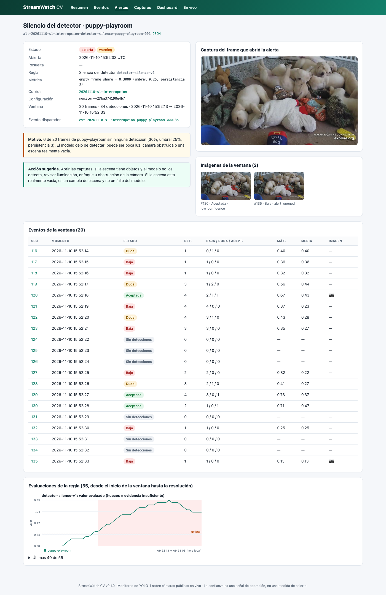
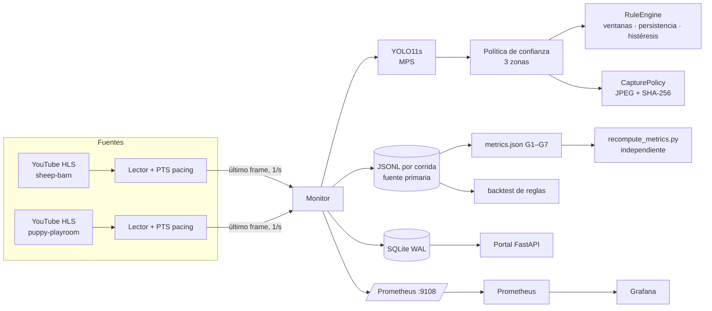
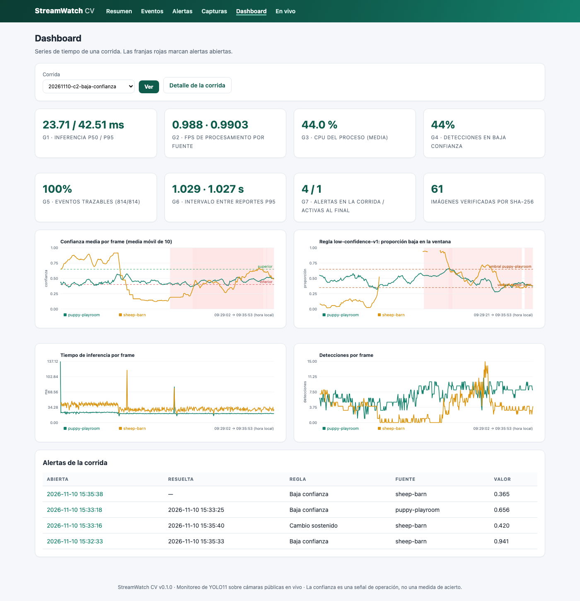
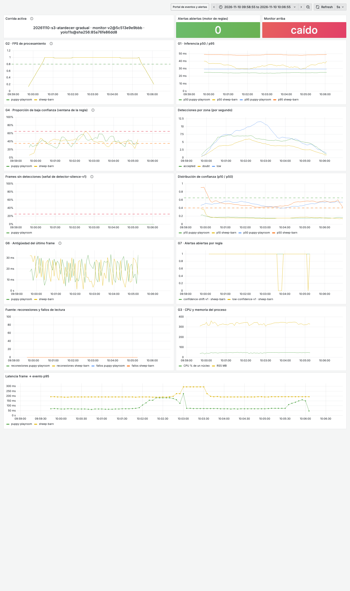

# StreamWatch CV

**Centro de monitoreo de computer vision en tiempo real.** YOLO11 detecta animales en dos cámaras públicas en
vivo (un granero de ovejas y una sala de cachorros), y el sistema vigila **cómo se comporta el modelo en
producción**. Registra cada inferencia como un evento trazable, guarda capturas verificables, calcula métricas de
operación G1–G7, alerta con reglas calibradas y muestra todo en un portal web, Prometheus y Grafana.

> **TL;DR (English).** A real-time ML monitoring system for object detection on live public cameras (AgTech
> livestock + a puppy room). YOLO11s runs on every sampled frame. Each inference becomes a schema-validated event
> with a verifiable image capture (SHA-256). Calibrated alert rules (low confidence, sustained confidence shift,
> detector silence, stale stream, model-version mismatch) are explained in a FastAPI portal and mirrored in
> Prometheus/Grafana. A rule **backtesting** engine replays recorded events to validate rule changes without
> re-running inference. Highlights: it caught a **real model blind spot without labels** (eight sleeping puppies
> in plain view, zero detections), and a rule change validated by backtest cut time-to-detect from **99 s to
> 12 s**. Every metric is independently recomputed from raw JSONL.

Proyecto 6 de MLOps (ITESO) · entrega individual · [índice de evidencias](evidencias/INDICE.md) ·
[inventario de extras](docs/EXTRAS.md)



## Qué hace

| | |
|---|---|
| **Fuentes** | Dos transmisiones en vivo de explore.org en YouTube: [Farm Sanctuary · Sheep Barn](https://www.youtube.com/watch?v=SnHke968zAA) (AgTech, ovejas) y [Warrior Canine Connection · Puppy Cam](https://www.youtube.com/watch?v=h-Z0wCdD3dI) (cachorros de perro de servicio). También acepta webcam, archivo de video o secuencia de imágenes |
| **Modelo** | YOLO11s preentrenado en COCO (detección), con identidad verificada por SHA-256: `yolo11s@sha256:85a76fe86dd8`. MPS en Apple M3. [Ficha](docs/MODELO.md) |
| **Muestreo** | 1 frame/s por cámara. Un hilo lector por fuente reproduce el HLS a su ritmo real ([PM-1](docs/POSTMORTEM.md)); el resto de frames se cuenta como descartado |
| **Confianza** | Tres zonas calibradas con una corrida de referencia: baja `< 0.40` ≤ duda `< 0.65` ≤ aceptada. Piso de salida 0.10 para que la zona baja sea observable. [Calibración](docs/CONFIANZA.md) |
| **Eventos** | Contrato v1 validado con Pydantic: identidad, modelo, configuración (`config_ref`), cada detección con su puntuación, zona y captura vinculada. [Contrato](docs/CONTRATO.md) |
| **Alertas** | `low-confidence`, `confidence-shift` (cambio sostenido frente a la referencia), `detector-silence`, `stream-stale` y `model-version`, con ventanas, mínimos de evidencia, persistencia e histéresis. [Reglas](docs/ALERTAS.md) |
| **Métricas** | G1–G7 calculadas desde los JSONL y recalculadas por un script independiente. [Métricas](docs/METRICAS.md) |
| **Portal** | Eventos y alertas con filtros, detalle con cajas sobre la captura, dashboard por corrida, vista en vivo, galería con revisión manual y exportación CSV/JSONL |
| **Observabilidad** | Prometheus (`:9108`) con reglas de segunda línea y Grafana provisionado, en `docker compose`. [Observabilidad](docs/OBSERVABILIDAD.md) |

## Arquitectura



Decisiones clave: los **JSONL son la fuente primaria** (SQLite es un índice reconstruible para el portal); cada
evento lleva `config_ref = <config_id>@<sha256>` de la configuración efectiva y `model_ref` con el hash de los
pesos; **evidencia insuficiente nunca cuenta como normalidad**; la confianza se trata como señal de operación, no
como probabilidad de acierto (no hay etiquetas, no se mide calidad predictiva).

## Resultados

| Corrida | Qué demuestra | Resultado |
|---|---|---|
| **C1** operación normal (10 min) | Sistema en régimen | 0.991 fps por cámara, inferencia p50/p95 26.6/45.4 ms, trazabilidad 1172/1172. Una alerta real: el operador hizo zoom sobre cachorros amontonados |
| **C2** baja confianza (7 min) | Apagón simulado en el granero, inferencia real | Confianza media 0.81 → 0.41; `low-confidence` y `confidence-shift` en el granero; cachorros como control |
| **S1** interrupción | Corte de 60 s y reconexión | `stream-stale` critical a los 14.1 s, resuelta 2 s después de reconectar. Además, un **fallo real del modelo** detectado sin etiquetas ([PM-4](docs/POSTMORTEM.md)) |
| **S2** cambio de versión | YOLO11n desplegado sin aprobación | `model-version` critical en el primer frame. En el granero, la confianza casi no cambió: solo la regla de identidad lo detecta |
| **S3** deriva gradual | Atardecer comprimido | `confidence-shift` a los 98 s, estable durante toda la deriva |
| **Backtest** `monitor-v2` | Mejora de reglas sobre C2 grabado | Tiempo de detección **98.9 s → 12.2 s**, sin alertas nuevas en C1 ni en la referencia |

Detalle: [ESCENARIOS.md](docs/ESCENARIOS.md) · Post-mortems: [POSTMORTEM.md](docs/POSTMORTEM.md) · Todas las
cifras se verifican con `python3 -I scripts/recompute_metrics.py evidencias/runs/<corrida>`.

| Dashboard de C2 | Grafana durante S3 |
|---|---|
|  |  |

## Reproducir

**Requisitos:** macOS, Linux o Windows con Python 3.12 y [uv](https://docs.astral.sh/uv/); Node.js
(recomendado: yt-dlp lo usa para resolver YouTube); Docker solo para `ops/`. Sin GPU funciona en CPU, más lento.

```bash
git clone https://github.com/stephy0410/streamwatch-cv.git && cd streamwatch-cv
uv sync --extra vision          # dependencias + Ultralytics/PyTorch (el extra se omite en CI)
uv run pytest                   # 71 pruebas no-vision + 2 con el modelo real

# Escenarios (los pesos se descargan del release oficial y se verifican por SHA-256 al primer arranque)
uv run streamwatch monitor --scenario config/scenarios/c1-normal.yaml         --duration 600 --export evidencias/runs
uv run streamwatch monitor --scenario config/scenarios/c2-baja-confianza.yaml --duration 420 --export evidencias/runs

uv run streamwatch portal       # http://127.0.0.1:8000
```

| Comando | Para qué |
|---|---|
| `streamwatch monitor --scenario <overlay> [--duration s] [--export dir]` | Ejecuta el monitor; al terminar escribe `metrics.json` y exporta la corrida |
| `streamwatch metrics <corrida>` | Recalcula `metrics.json` desde los JSONL |
| `python3 -I scripts/recompute_metrics.py <corrida>` | Verificación independiente (solo biblioteca estándar) |
| `streamwatch reference <corrida> --out config/reference/<id>.json` | Calibra umbrales y reglas desde una corrida normal |
| `streamwatch backtest <corrida> [--config ...]` | Reevalúa las reglas sobre eventos grabados (sin `--config`: prueba de fidelidad) |
| `streamwatch import <corridas…>` | Carga corridas exportadas en el SQLite del portal |
| `docker compose -f ops/docker-compose.yml up -d --build` | Prometheus `:9090`, Grafana `:3000`, portal de evidencias `:8080` |

Todos los escenarios y su duración están en [`config/scenarios/README.md`](config/scenarios/README.md). La
configuración base es [`config/monitor.yaml`](config/monitor.yaml) (`monitor-v2`); C1 y C2 se ejecutaron con
`monitor-v1`, y su configuración efectiva quedó guardada en cada `config.json`.

## Estructura

```
src/streamwatch/   sources · detector · confidence · events · alerts · captures · storage · monitor
                   metrics · reference · backtest · telemetry · resources · cli · portal/
config/            monitor.yaml · scenarios/*.yaml · reference/reference-v{1,2}.json
scripts/           recompute_metrics.py (verificación independiente)
ops/               docker-compose · Prometheus (reglas) · Grafana (dashboard) · Dockerfile del portal
docs/              MODELO · CONTRATO · CONFIANZA · ALERTAS · METRICAS · ESCENARIOS · OBSERVABILIDAD · POSTMORTEM · EXTRAS
evidencias/        runs/ · metricas/ · portal/ · observabilidad/ · backtests/ · revisiones/ · INDICE.md
```

## Límites

- **Sin etiquetas reales**: no se mide precisión ni recall. La confianza avisa de un posible cambio y abre una
  investigación; no confirma pérdida de calidad.
- La referencia se tomó una mañana, con 10 minutos por cámara. Para operar 24/7 convendría una referencia por
  franja horaria (el escenario de anochecer real lo explora).
- Las cámaras son transmisiones públicas de terceros: la escena cambia sola (los animales se van, el operador
  hace zoom). El monitor lo registra; no lo controla.
- COCO no distingue cabras ni razas, y YOLO11s tiene un punto ciego con cachorros amontonados boca arriba
  ([PM-4](docs/POSTMORTEM.md)).
- El monitor corre en un solo proceso, con SQLite local. Para más cámaras, el siguiente paso sería separar la
  captura de la inferencia con una cola.

## Autoría y procedencia

- **Autora:** Stephanie Borrego Arroyo ([@stephy0410](https://github.com/stephy0410)), entrega individual.
- **Aportación propia:** todo el código de `src/`, `scripts/`, `tests/` y `ops/`: lectores de stream con pacing
  por PTS, política de confianza, contrato de eventos, motor de reglas, calibración, métricas, recálculo
  independiente, backtest, portal y stack de observabilidad. También la configuración, los escenarios, la
  evidencia y la documentación. El trabajo está organizado en issues y PRs en GitHub (#1–#15 y #29).
- **Herramientas:** desarrollado con asistencia de un asistente de programación con IA (Claude Code), bajo mi
  dirección y revisión.
- **Componentes reutilizados:** pesos YOLO11 preentrenados en COCO y la biblioteca de inferencia de
  [Ultralytics](https://github.com/ultralytics/ultralytics) (AGPL-3.0, por eso este repositorio también es
  AGPL-3.0), OpenCV, yt-dlp, FastAPI, Jinja2, Pydantic, prometheus-client, psutil, Prometheus y Grafana.
- **Fuentes de video:** transmisiones públicas de [explore.org](https://explore.org) (Farm Sanctuary y Warrior
  Canine Connection). Las capturas de `evidencias/` son fotogramas de esas transmisiones y se conservan como
  evidencia académica del monitoreo.
